# 🛒 Full-Stack E-Commerce Platform

A production-style e-commerce platform built with **Next.js**, **Node.js**, **MongoDB**, and **JWT Authentication**, supporting role-based access for Admins, Sellers, and Customers.

---

## 🧱 Tech Stack

### Frontend
- **Framework:** Next.js (React)
- **Styling:** Tailwind CSS / CSS Modules
- **HTTP Client:** Axios
- **State & Auth:** React Context / Custom Hooks

### Backend
- **Runtime:** Node.js + Express.js (MVC Architecture)
- **Database:** MongoDB + Mongoose
- **Authentication:** JWT (JSON Web Tokens) & Role-Based Access Control (RBAC)

---

## 📁 Project Structure

```text
Ecommerce-next.js-project/
├── frontend/                # Next.js App
│   └── src/
│       ├── pages/            # Customer, Seller, and Admin pages
│       ├── components/       # Reusable UI components
│       └── utils/            # Helper functions & API handlers
│
└── backend/                 # Express API
    └── src/
        ├── models/           # Mongoose schemas
        ├── controllers/      # Route controllers
        ├── routes/           # API Endpoints
        └── middleware/       # Auth & Role-based guards


        ## ✨ Features

### 🔐 Authentication & Roles
- **JWT Auth:** Secure registration, login, and token management.
- **Role-Based Access (RBAC):** Distinct permissions and dashboards for **Customer**, **Seller**, and **Admin**.

### 🛍️ Customer
- **Product Browsing:** Filter by category, search, and view detailed product specs.
- **Cart & Checkout:** Manage items in the shopping cart with real-time price updates.
- **Order Tracking & Profile:** View order history, profile details, and account management.

### 🏪 Seller Dashboard
- **Product Management:** Add new listings, edit existing products, and manage stock.
- **Coupon Controls:** Create and manage promo coupons scoped to their store.

### ⚡ Admin Dashboard
- **Platform Analytics:** Overview of system users, orders, and sales metrics.
- **User & Coupon Management:** Moderate users and control platform-wide coupons.

---

## 🎥 Demo

📺 [**Watch the Full Demo Video on Google Drive**](https://drive.google.com/drive/folders/1PQzctcesAlAwI5ib4fDbUQRYTlYl37II?usp=drive_link)

---

## 📸 Screenshots

### Storefront & Welcome
| Hero Section | Welcome Back |
| :---: | :---: |
| 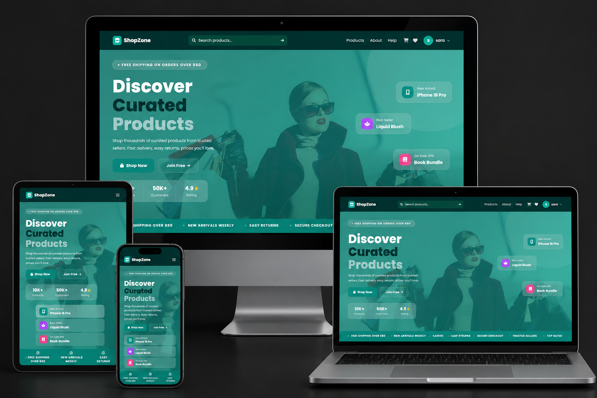 | 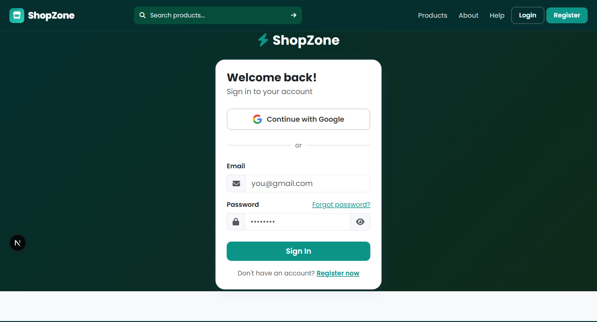 |

| Products Page (Layout 1) | Products Page (Layout 2) | Single Product |
| :---: | :---: | :---: |
| 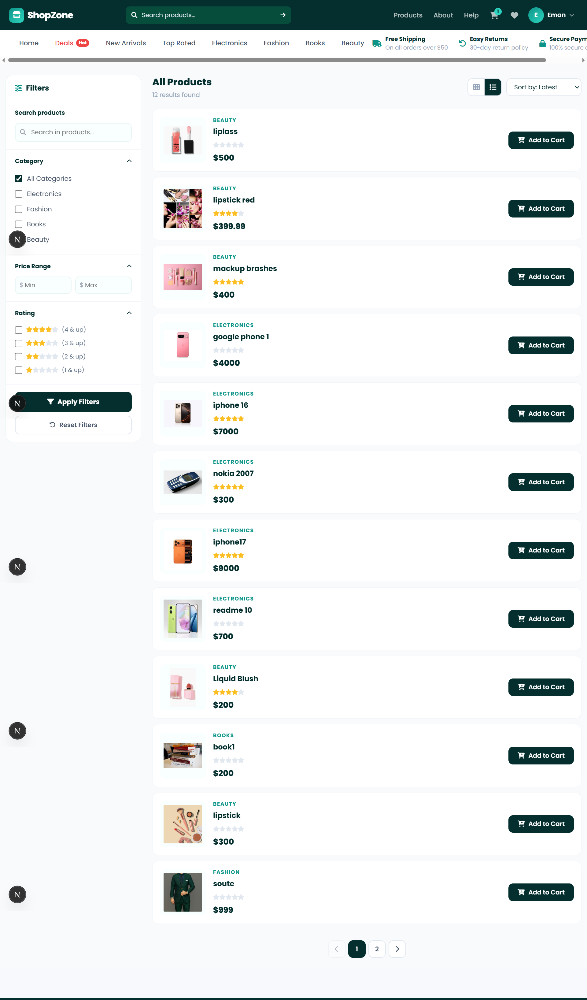 | 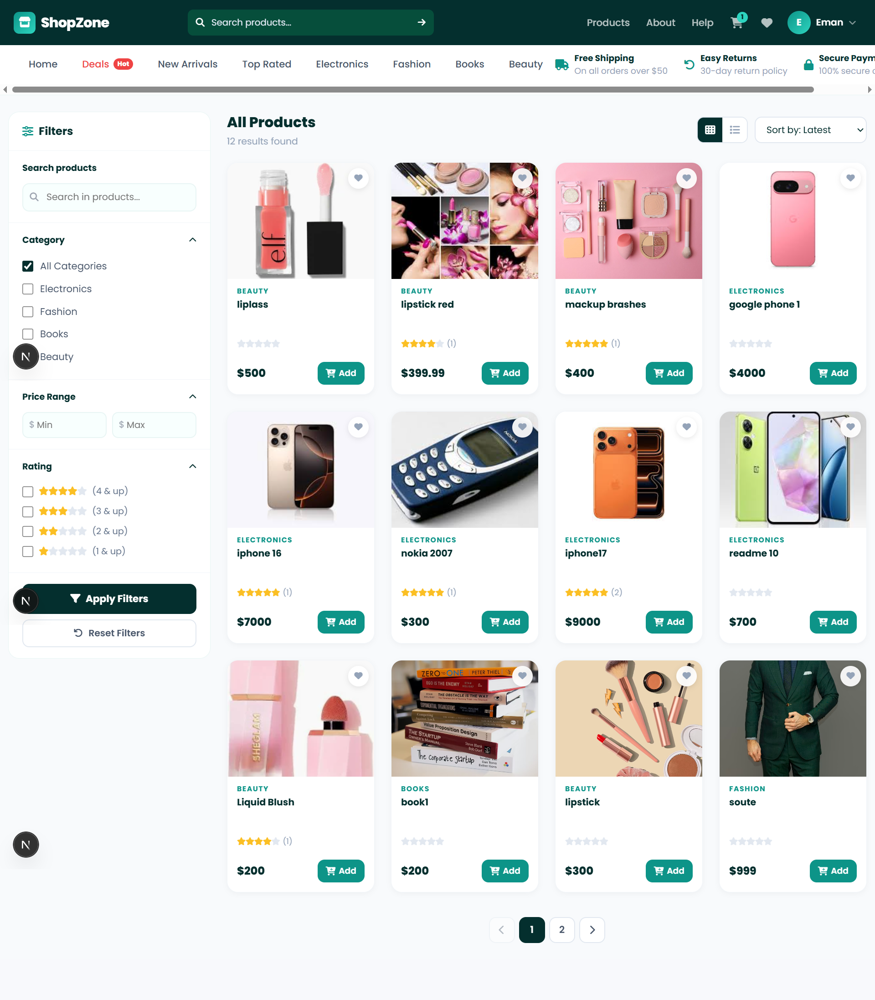 | 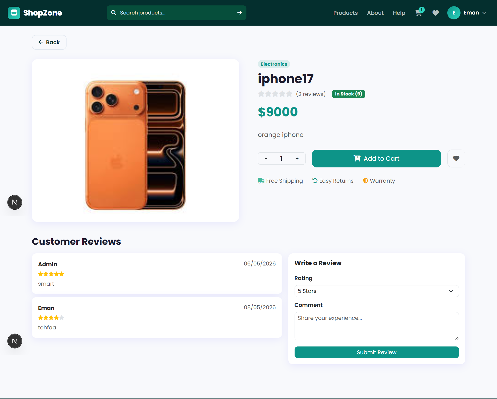 |

### Dashboards & Management
| Dashboard Overview | Users Management | Coupons Management |
| :---: | :---: | :---: |
| 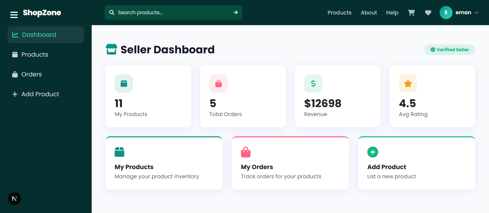 | 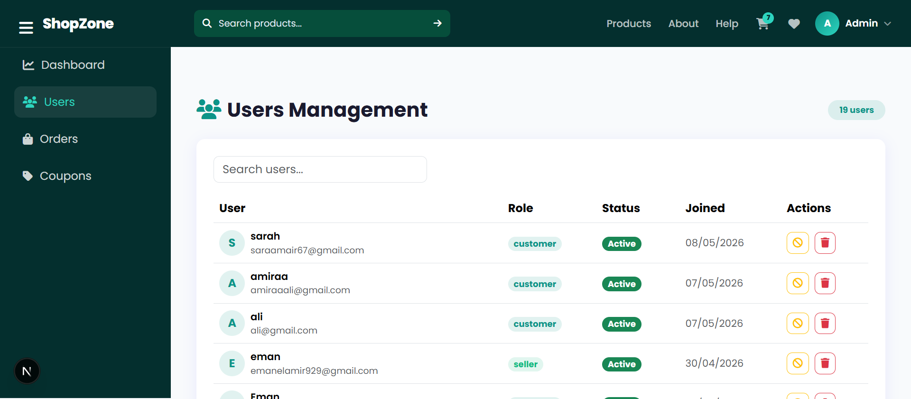 | 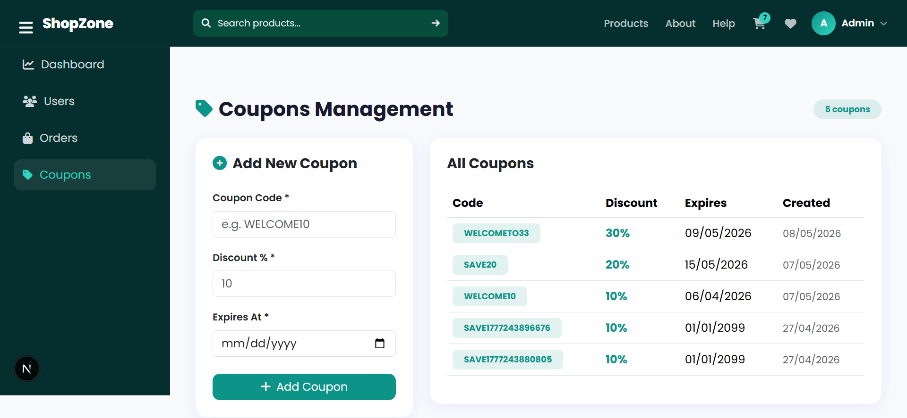 |

| Add Product Page | User Profile | Single Product View 2 |
| :---: | :---: | :---: |
| 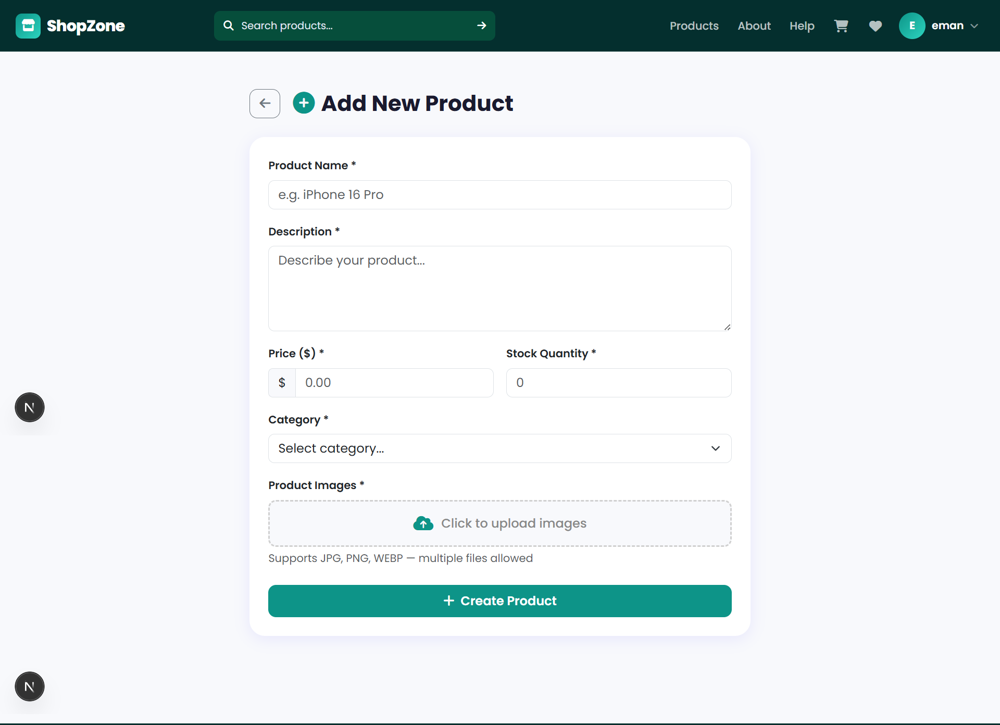 | 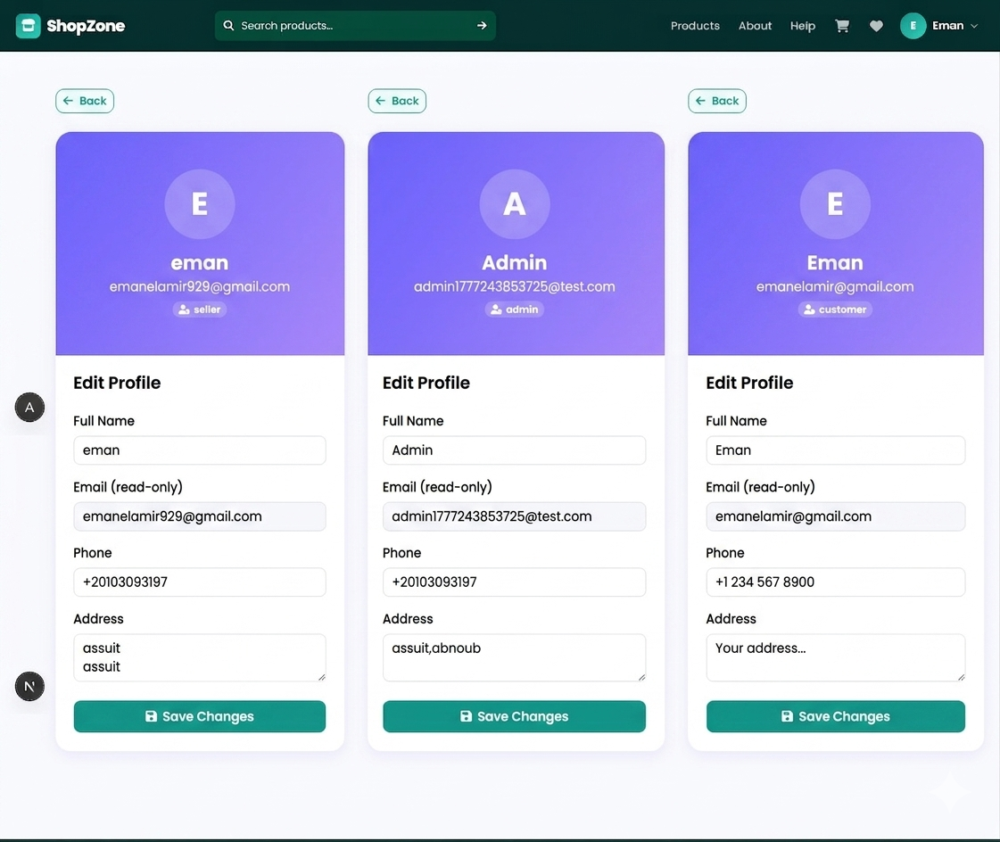 | 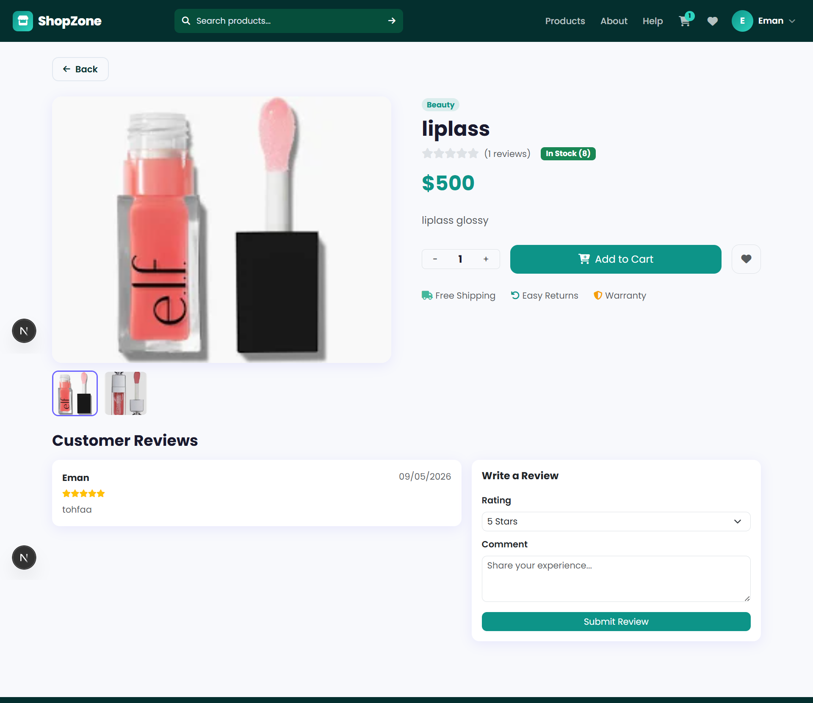 |

---

## ⚙️ Setup Instructions

### Prerequisites
- **Node.js** (v18+ recommended)
- **MongoDB** running locally or via MongoDB Atlas

---

### 1. Backend Setup

```bash
cd backend
npm install